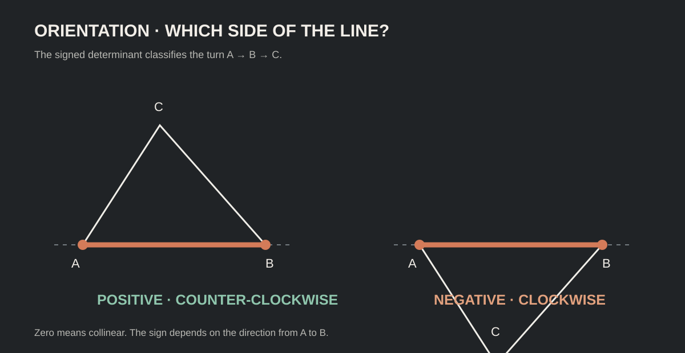
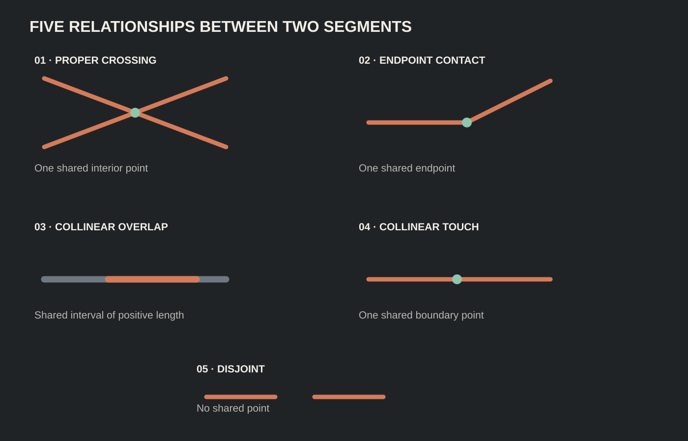
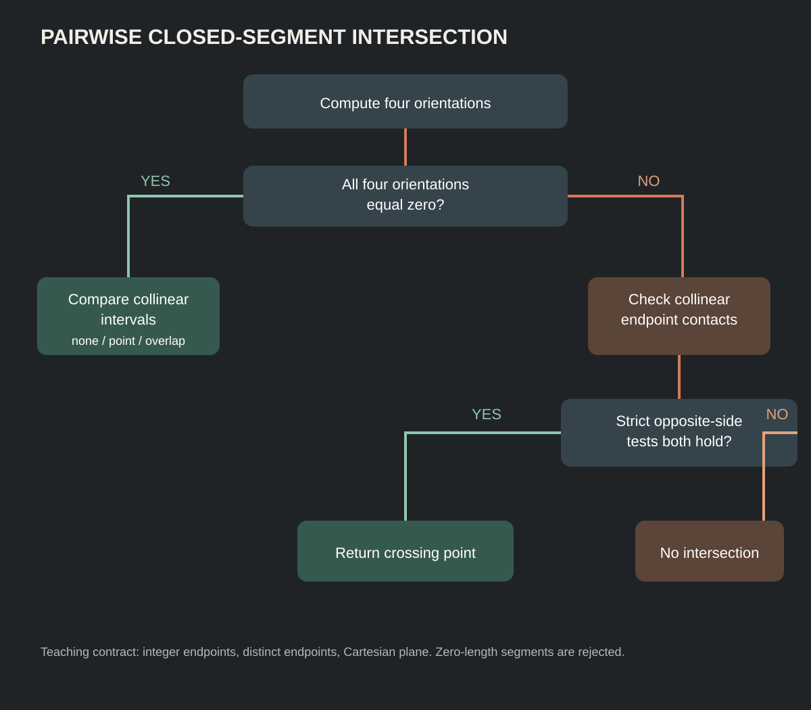

# Field Guide 01 — Do Two Line Segments Meet?

**Spatial Methods · Computational Geometry**  
**Release:** 01 · **Version:** 1.0  
**Depth:** FOUNDATIONS · METHOD · IMPLEMENTATION · ANALYSIS  
**Prerequisites:** Basic coordinate geometry  
**Study time:** 45–75 minutes

---

## The question

Two line segments appear to cross on a map. Do they actually meet?

That question is deceptively important. A road crossing, a parcel boundary, a utility connection and a polygon overlay all depend on knowing how linework relates geometrically.

A computer cannot rely on visual appearance. It needs a precise definition, a method for evaluating it, and a policy for boundary cases.

This guide develops the pairwise segment-intersection problem from geometric intuition to algorithmic reasoning. It then explains where the method fits—and where it does not—in larger spatial systems.

## 1. A line is not a segment

A line extends indefinitely in both directions. A line segment is the finite portion between two endpoints.

Two infinite lines can intersect even when the intersection lies outside one of the finite segments. Therefore, solving the infinite-line equation alone does not answer the segment question.

For two closed segments, there are three useful result types:

- **None:** the segments share no point.
- **Point:** they cross or touch at exactly one point.
- **Overlap:** they share a segment of positive length.

This three-way result is more informative than a Boolean answer. It distinguishes a junction from a shared boundary.

## 2. Orientation: the key geometric predicate

Take three points A, B and C. Imagine travelling from A to B and then looking toward C.

The signed determinant tells us whether C lies to the left of the directed line AB, to the right, or directly on it.

`orient(A,B,C) = (B_x-A_x)(C_y-A_y) - (B_y-A_y)(C_x-A_x)`

- Positive: counter-clockwise turn; C is left of AB.
- Negative: clockwise turn; C is right of AB.
- Zero: A, B and C are collinear.

The determinant is twice the signed area of triangle ABC. Its sign—not its magnitude—is what the intersection predicate needs.

## 3. From orientation to intersection

For segments AB and CD, calculate four orientations:

- C relative to AB
- D relative to AB
- A relative to CD
- B relative to CD

When each pair has strictly opposite signs, the segments cross properly: each segment straddles the supporting line of the other.

But a complete closed-segment test must also handle zero orientation values. A point can be collinear with a supporting line but still lie beyond the finite segment.

That is why the algorithm combines orientation with an on-segment test that checks coordinate bounds.

If all four orientations are zero, the segments are collinear. Project them onto a coordinate axis and compare their one-dimensional intervals. Their intervals may be disjoint, touch at one endpoint, or overlap over a positive length.

## 4. The algorithm at a glance

1. Validate the input contract. This teaching implementation rejects zero-length segments.
2. Compute the four orientation determinants.
3. If all are zero, classify the collinear interval overlap.
4. Check endpoint-on-segment cases.
5. If both endpoint pairs strictly straddle, construct the crossing point.
6. Otherwise, return no intersection.

The decision process is shown below.

## 5. Why exact arithmetic matters

The orientation test is a sign decision. If floating-point rounding changes a determinant's sign near zero, the algorithm can make a topologically wrong decision.

For integer input coordinates, Python's arbitrary-precision integers evaluate the orientation determinant exactly. A proper crossing can nevertheless have fractional coordinates. The reference implementation uses rational numbers for the constructed intersection instead of silently rounding it.

This is a deliberately narrow teaching contract:

- integer-coordinate endpoints;
- two distinct endpoints per segment;
- planar Cartesian coordinates;
- no tolerance or coordinate snapping.

It is not a general floating-point geometry engine. Robust predicates, coordinate reference systems, geometry validity and precision models need explicit treatment in real GIS workflows.

## 6. Complexity: one pair versus many segments

For one pair of segments, a fixed number of arithmetic operations and comparisons is performed: O(1) time and O(1) auxiliary space under the usual unit-cost arithmetic model. Very large integer values have non-constant bit costs.

For n segments, testing every unordered pair takes:

`n(n-1)/2 = O(n^2)`

This may be acceptable for small inputs or when the output itself is quadratic. When the task is to report intersections among a large set of segments, plane-sweep methods such as Bentley–Ottmann can be more efficient. Under its classical general-position assumptions, the output-sensitive reporting bound is O((n+k) log n), where k is the number of reported intersections.

That is a different algorithmic problem. Do not confuse a correct pairwise predicate with a complete all-segment intersection system.

## 7. Practical checklist

Before using segment intersection in an applied workflow, ask:

- Are the coordinates in a suitable common projected CRS?
- What does “intersection” mean for this application: point contact, overlap, or either?
- Are geometries valid and non-degenerate?
- What precision model is used?
- Are robust predicates required?
- How are candidate segment pairs selected?
- Is an all-pairs algorithm affordable?
- Has the implementation been tested on representative and adversarial cases?

## 8. Further study

**Implementation:** run the tested Python example and inspect the exact rational output.  
**Analysis:** study adaptive-precision predicates and the handling of degeneracies.  
**Research:** compare pairwise testing with sweep-line algorithms.  
**Teaching:** use the companion lesson sequence and exercises to have learners predict cases before running code.

## References

- Bentley, J. L. and Ottmann, T. A. (1979). “Algorithms for Reporting and Counting Geometric Intersections.” *IEEE Transactions on Computers*, C-28(9), 643–647. https://doi.org/10.1109/TC.1979.1675432
- Shewchuk, J. R. (1997). “Adaptive Precision Floating-Point Arithmetic and Fast Robust Geometric Predicates.” *Discrete & Computational Geometry*, 18, 305–363. https://doi.org/10.1007/PL00009321
- Goodrich, M. T. and Wenk, C. “Line Segment Intersection” lecture notes: https://ics.uci.edu/~goodrich/teach/geom/notes/LineSweep.pdf
- Universitat Politècnica de Catalunya, “Orientation Tests”: https://dccg.upc.edu/wp-content/uploads/2021/09/GeoC-Orientation-tests-R.pdf

## Companion resources

- [Canonical technical lesson](../../algorithms/geometry/segment-intersection.md)
- [Python implementation and tests](../../implementations/python/segment-intersection/README.md)
- [Implementation walkthrough](../../implementations/python/segment-intersection/implementation-walkthrough.md)
- [Educator companion](educator-companion.md)
- [Learning release 01](../../docs/patreon-first-learning-pack.md)

---

**Spatial Methods**  
Understand the methods behind spatial data, maps, models and decisions.
